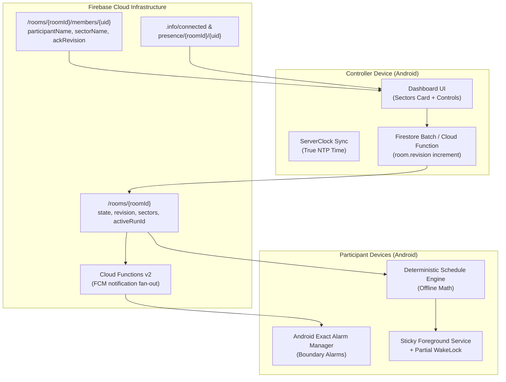

# Timer Be Perfect (v3.0.0)

<p align="center">
  
</p>

<p align="center">
  <b>A resilient, multi-device synchronized timer and event coordinator for church youth activities.</b>
</p>

<p align="center">
  Developed by <b>Abanoub Samy (<a href="https://github.com/CyberBonk">CyberBonk</a>)</b>.
</p>

---

## 📌 What is Timer Be Perfect?

**Timer Be Perfect** is an Android event-coordination app purpose-built for church student activities and multi-stage competitions. It synchronizes timed rounds across dozens of distributed participant devices, gives the event leader instant live control, and—most importantly—**continues running smoothly even when internet drops or phones are locked in pockets**.

The installed Android app name is **Timer Be Perfect**.

---

## 👥 The Two Core Roles

| Role | How to Access | Responsibilities & Capabilities |
| :--- | :--- | :--- |
| **👑 Controller** | Tap **"Create Room"** on Home | • Creates the room and generates a 6-digit PIN & QR code.<br>• Defines, renames, and manages event **Sectors**.<br>• Sets round counts, standard durations, and cooldown intervals.<br>• Starts, pauses, resumes, skips rounds, or adds/subtracts time (`+1m`, `+5m`, `-1m`, `-5m`).<br>• Monitors live participant presence and revision sync state.<br>• Broadcasts room-wide announcements or sector-targeted alerts (`@SectorName`). |
| **📱 Participant** | Tap **"Join Room"** on Home | • Enters the 6-digit PIN or scans the Controller's QR code.<br>• Enters their own name and selects their assigned **Sector** from the live dropdown.<br>• Follows real-time synchronized countdowns, round numbers, and cooldown intervals.<br>• Receives persistent lock-screen alarms at every round boundary.<br>• Receives urgent sector announcements and sends messages back to the Controller. |

---

## 🌟 Key Features & Systems (Version 3.0)

### 🏢 1. Multi-Participant Sectors
- In previous versions, each device represented one flat sector. In **v3.0**, multiple participants can join under the same sector (e.g., *Stage Crew*, *Sound*, *Counseling / مشورة*).
- **Controller Sector Management Card**: Located right on the Controller Dashboard before starting an event. Controllers can add new sectors (full Arabic & English support), rename existing sectors, or delete empty ones.
- **Strict Dropdown Selection**: When participants join, the sector field is strictly a live-sync dropdown (no typing typos). If the controller hasn't made sectors yet, the dropdown stays disabled until they do.
- **Sector Cards on Dashboard**: Controller and participant views group joined members into distinct Sector Cards displaying real-time headcounts and member statuses.

### 🔄 2. The 4-State Sync Matrix
Real-world church events have shaky Wi-Fi and mobile data. Traditional "Online/Offline" indicators don't tell you if a participant actually has the latest schedule changes. The **4-State Sync Matrix** separates socket connectivity from schedule state:

| State | Badge Color | Icon | Meaning & Operational Action |
| :--- | :--- | :---: | :--- |
| **Synced + Online** | 🟢 Green | 📡 Tower | **Perfect**: Device is connected and has the exact current room revision. |
| **Synced + Offline** | 🟠 Orange | 📵 Signal Off | **Safe**: Device dropped internet, but *already cached* the latest schedule before dropping. It will complete rounds on time automatically. |
| **Out of sync + Online** | 🟡 Yellow | 📡 Tower | **Lagging**: Device is connected to the internet, but has slow latency or hasn't finished fetching the latest time adjustment. |
| **Out of sync + Offline** | 🔴 Red | 📵 Signal Off | **Action Required**: Device is disconnected *and* missed an important schedule change (e.g., round skipped or time added). Controller needs to inform them physically. |

### 🔋 3. Background Keepalive & Android OEM Protection
- **No Background Freeze**: Android Doze and OEM battery managers (Samsung, Xiaomi, Huawei EMUI) often cut network sockets and freeze Dart isolates when screens turn off.
- **Sticky Foreground Service & Partial WakeLock**: When an active room is running, the app holds a lightweight Android `PARTIAL_WAKE_LOCK` and displays an ongoing notification, keeping CPU timers and Firebase sockets alive while locked in pockets.
- **Deterministic Offline Schedule Engine**: Timers do *not* poll Firebase every second. The app caches the exact absolute start/end timestamps and derives remaining time mathematically. Even in total network blackouts, the round alarm sounds at the exact second.

### 🔊 4. Bulletproof Alarms & Huawei EMUI Audio Protection
- Custom high-priority alarm notification channels (`Importance.max`) with bundled audio.
- Detects silent/vibrate modes and provides a **Force Max Volume** feature that elevates all stream volumes (Alarm, Media, Notification) and bypasses OEM sound drops.
- Test Alarm buttons in Settings and Participant screens let users verify sound readiness before the event begins.

### 📢 5. Sector-Targeted @Mentions & Announcements
- In the **Announcements** tab, typing `@` brings up auto-complete chips prioritizing `@SectorName`.
- Mentioning `@SectorName` routes an exclusive high-priority push alert directly to all devices in that sector.
- Individual `@ParticipantName` mentions are also supported for 1-on-1 direct notices.

### ⚙️ 6. Dynamic Limits & Settings
- Configurable controls in **Settings** for:
  - Maximum round duration (up to 120 minutes).
  - Maximum cooldown duration (up to 15 minutes / 900s).
  - Cooldown step intervals (default 15s).
- Changes are saved locally via `SharedPreferences` and dynamically adapt the Controller pickers.

---

## 🏗️ Architecture & Technical Design



### Dual-Path Execution Model
- **Primary Path**: High-security Cloud Functions v2 for atomic operations, schedule generation, and FCM push notifications.
- **Client Fallback Path**: If Cloud Functions are unreachable or on a Firebase Spark (free) plan, the app automatically executes an atomic direct Firestore batch write with complete client-side security rules. The system *never* goes down just because a serverless function failed.

---

## 📱 Android Compatibility Matrix

- **Primary Target**: Android 10 (API 29) through Android 14+.
- **Compatibility Floor**: Android 8.0 Oreo (API 26) with full notification channels.
- **Permissions**:
  - `POST_NOTIFICATIONS`: For ongoing timer notifications and urgent announcements.
  - `SCHEDULE_EXACT_ALARM`: For second-accurate boundary alarms.
  - `FOREGROUND_SERVICE` & `WAKE_LOCK`: For screen-off survivability.
  - `RECEIVE_BOOT_COMPLETED`: Restores scheduled alarms if a device reboots mid-event.

---

## 🧪 Testing & Verification

The codebase maintains strict automated test coverage across unit, state, and widget layers:

```powershell
# Run the complete test suite (57+ automated tests)
flutter test

# Run static analysis (0 warnings, 0 lints)
flutter analyze
```

### Test Coverage Highlights:
- **`schedule_engine_test.dart`**: Verifies exact phase math, 3-2-1 countdowns, cooldown boundaries, pause freezes, and zero-cooldown transitions.
- **`sector_management_test.dart`**: Verifies adding, renaming (casing updates), and deleting sectors with member protection.
- **`announcements_mention_test.dart`**: Verifies sector `@mentions`, participant targeting, and announcement fan-out.
- **`ui_components_test.dart`**: Verifies 4-State Sync Matrix badges, Arabic localization, and timer rendering.

---

## 🛠️ Build & Release Commands

To build release artifacts with Dart obfuscation and split ABIs:

```powershell
# Build release APKs (armeabi-v7a, arm64-v8a, x86_64)
flutter build apk --release --split-per-abi `
  --obfuscate --split-debug-info=build/symbols

# Build production Android App Bundle (AAB)
flutter build appbundle --release `
  --obfuscate --split-debug-info=build/symbols
```

---

## 👨‍💻 Author & Credits

Designed, architected, and built by **Abanoub Samy (CyberBonk)** for church youth ministries.

- **GitHub**: [@CyberBonk](https://github.com/CyberBonk)
- **Repository**: [CyberBonk/Timer-Be-Perfect](https://github.com/CyberBonk/Timer-Be-Perfect)
- **License**: MIT
